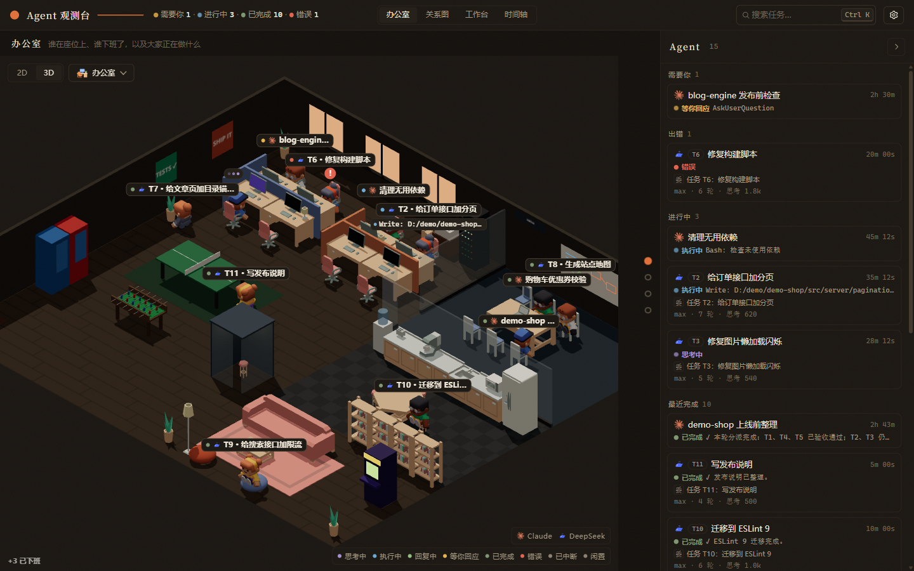
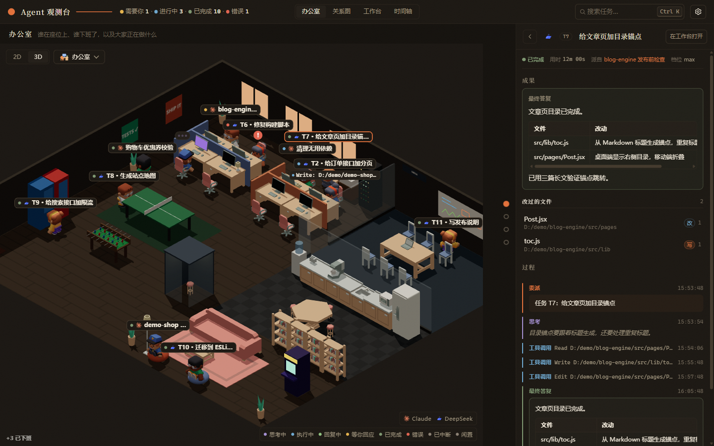
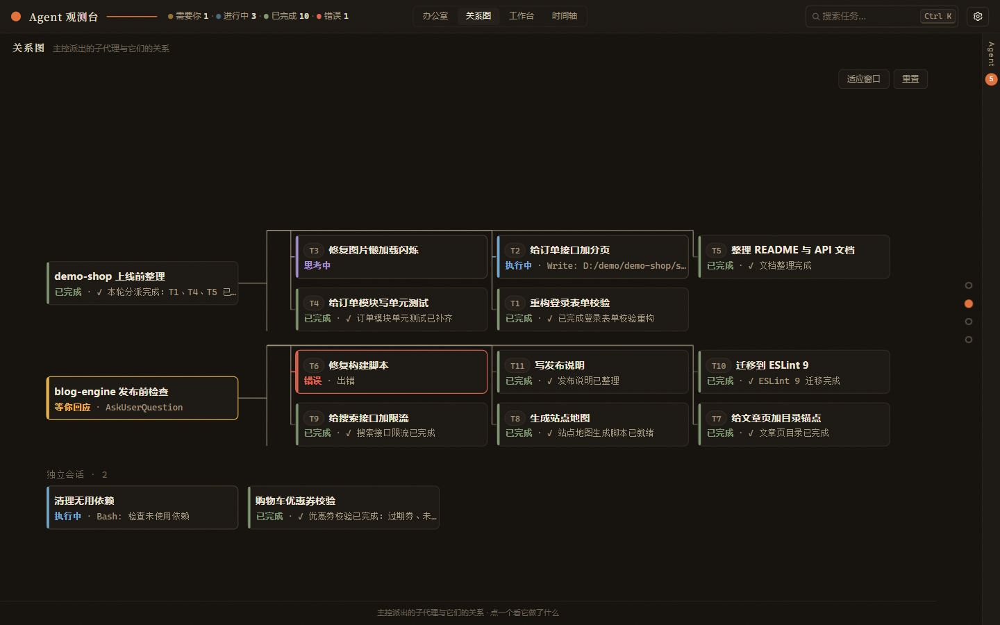
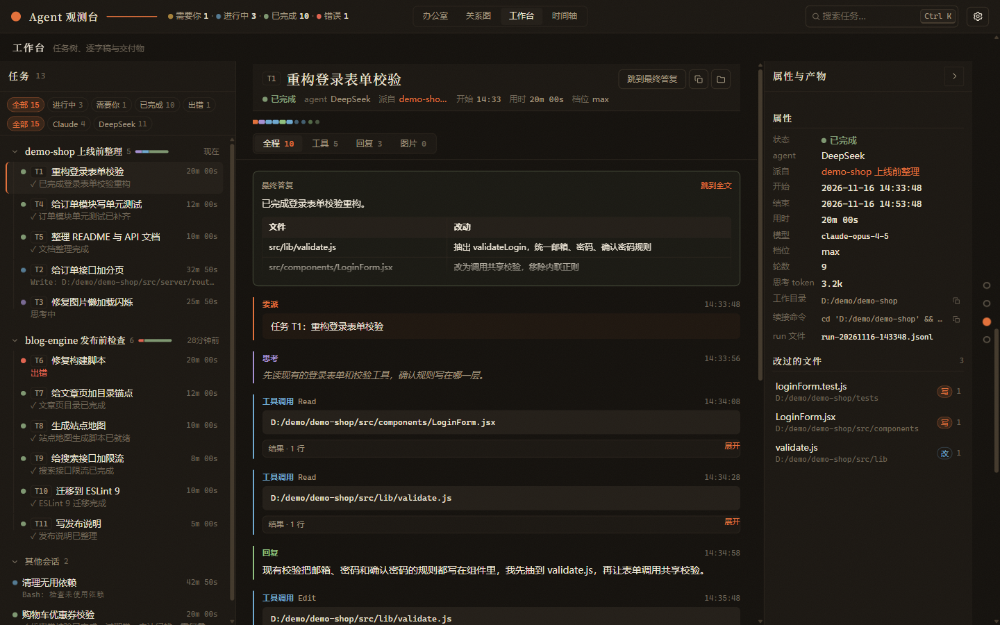
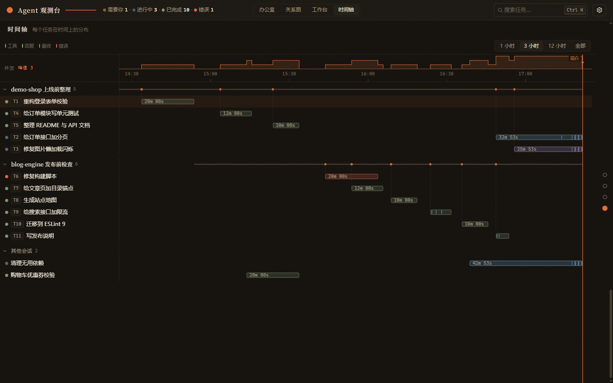
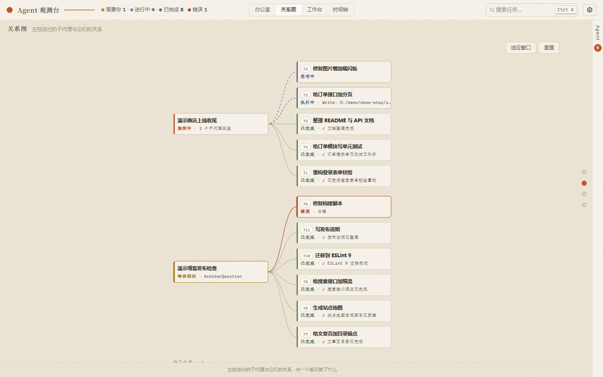

# Agent 观测台（agent-dash）

> 本项目基于开源项目 **[whatsmyagentdoing v0.8.1](https://github.com/Charonyuu/whatsmyagentdoing)**（作者 cheoyu，MIT 许可）魔改，保留原项目的 MIT 许可证与版权声明。感谢原作者。

一个跑在本机的 AI Agent 只读观测台：把 Claude Code、Codex、Gemini CLI、DeepSeek 子代理等本机 agent 的会话日志，变成可以一眼看懂的实时看板。零运行时依赖，克隆下来就能跑，不需要 `npm install`，不需要配置 API key。



## 四个视图

### 办公室

3D 等距办公室。正在工作的 agent 坐在工位上：思考时冒想法气泡，跑工具时屏幕滚动代码，需要你时站起来招手；最近完成的 agent 会下班闲逛（茶水间、沙发、书架、白板、街机、乒乓球……）。支持 2D / 3D 切换，可拖拽旋转、滚轮缩放。右侧 Agent 侧栏按「需要你 / 出错 / 进行中 / 最近完成」分组；点办公室里的一个小人，就能看到它的最终答复、改过的文件和完整过程。



### 关系图

主控 agent 在左，派出的子代理向右逐列展开，孙代理继续向右；连线表示委派关系，运行中的链路有流动效果。一眼看清「谁在替谁干活」。



### 工作台

三栏布局：左栏任务树（按需要你 / 进行中 / 已完成分组），中栏是任务详情——事件条、对话记录、工具调用、最终答复，右栏是属性、改动文件和图片。



### 时间轴

每个任务一条泳道，按与工作台相同的分组和筛选排列；右侧是固定宽度的时间窗，滚轮/拖拽只缩放或平移时间范围，不横向滚动。



右上角的搜索框（`Ctrl K`）和状态筛选在三个列表视图之间共用；界面支持简体中文、繁體中文、English、日本語、한국어、Español、Français、Deutsch、Português。

## 启动

要求 Node.js 18+（OpenCode / Hermes 的 SQLite 读取需要 22.13+，低版本会自动跳过这两个 agent，其余功能不受影响）。

```bash
node bin/cli.js --port 4600
```

然后打开 <http://127.0.0.1:4600>。

常用参数：

```bash
node bin/cli.js --port 4600 --no-open   # 不自动打开浏览器
node bin/cli.js --port 4600 --hours 12  # 只看最近 12 小时
node bin/cli.js --demo                  # 用一套假数据体验界面
node bin/cli.js --private               # 隐藏提示词、回复和标题，只显示状态
node bin/cli.js --host 0.0.0.0          # 监听所有网卡，局域网可访问
```

默认端口是 4545，被占用时会自动顺延到下一个空闲端口。完整参数见 `node bin/cli.js --help`。

加 `--host 0.0.0.0` 后，同一 Wi-Fi 下的 iPad、手机可以直接打开启动时打印的局域网地址（如 `http://192.168.1.23:4600`）。看板**没有密码**，同一网络里的人都能看到全部内容，只在可信网络里这样用；默认仍只监听 `127.0.0.1`。

## 只读原则

- **只读日志**：只 tail / 读取本机 agent 的会话日志（如 Claude Code 的 `~/.claude/projects`、DeepSeek 子代理的 `~/.claude/deepseek-runs`、Codex、Gemini CLI 等），不写入、不修改、不删除任何会话文件。
- **默认只监听本机**：HTTP 服务默认绑定 `127.0.0.1`，并拒绝非本机 Host 的请求；只有显式加 `--host 0.0.0.0` 才监听局域网（此时放行本机各网卡 IP 的 Host）。看板没有密码，局域网模式仅限可信网络。
- **无遥测**：本 fork 已关闭上游的版本检查，不会向 GitHub 或任何外部服务发请求。
- **不打扰 agent**：不注入 hook、不改配置、不要求 API key；看板挂了也不影响正在运行的会话。
- **唯一的可选写操作**是 `--install-hook`：在 Claude Code 设置里加一个「等待你确认」的提示 hook，并在 `~/.whatsmyagentdoing/` 写一个标记文件。不运行它就完全不写。
- **`--private`** 下，提示词、回复和标题不会发送到浏览器页面。

## DeepSeek 子代理适配

本 fork 在 `src/deepseek.js` 中增加了 DeepSeek 子代理适配层。

`ask_deepseek.py` 启动的每个 DeepSeek 子会话都是一个真实的 `claude.exe -p` 进程，并在 `~/.claude/deepseek-runs/` 留下两个文件：`run-YYYYmmdd-HHMMSS.jsonl`（完整事件流）和同名 `.meta.json`（提示词、目录、档位等元信息）。适配层把每次运行当作一个普通会话：

- 从 JSONL 里还原思考、工具调用、工具参数、工具结果和图片；
- 与 Claude Code 会话一起出现在办公室、关系图、工作台和时间轴中；
- 根据 `.meta.json` 里的提示词识别任务标签（如 `T8a`），区分同一个主控派出的并行子代理；
- 只读这些日志，不做任何写入。

主控与子代理的父子关系来自 Claude Code 的 subagent / 委派记录以及 run 元信息，因此 DeepSeek 子代理会自然出现在关系图的委派链里。

## 支持的 agent

Claude Code（CLI / 桌面 / IDE）、Codex、Gemini CLI、Antigravity CLI、Copilot CLI、OMP、Pi、Kimi Code、DeepSeek Harness（DSH）、Grok Build、OpenCode、Hermes，以及本 fork 额外接入的 DeepSeek 子代理。各客户端的日志位置与覆盖方式见 `node bin/cli.js --help`；上游的完整说明见 [whatsmyagentdoing](https://github.com/Charonyuu/whatsmyagentdoing)。

## 隐私

所有数据都留在本机。页面通过 Server-Sent Events 从本地服务获取状态；`--private` 可隐藏对话正文。主控标题优先取 Claude 桌面客户端 `claude-code-sessions` 里的会话名（只读 `cliSessionId`、`title` 等元数据，不读对话内容）。日志格式不是公开 API，客户端升级后状态解析可能退化，欢迎提 issue。

## 浅色主题

界面跟随系统主题，也可以在右上角设置里固定为深色或浅色。浅色下的关系图：



## 开发

`scripts/make-demo-data.js` 会生成一套完全虚构的 agent 日志（demo-shop / blog-engine 两个项目、若干 DeepSeek 子代理和独立会话），只写入 `--out` 指定的目录，适合截图或本地体验：

```bash
node scripts/make-demo-data.js --out /tmp/agent-dash-demo
```

再用这个目录当 home 起第二个实例（示例用 4610，避免影响正在运行的实例）：

```bash
# macOS / Linux
HOME=/tmp/agent-dash-demo node bin/cli.js --port 4610

# Windows (PowerShell)
$env:USERPROFILE = "C:\Temp\agent-dash-demo"; node bin/cli.js --port 4610
```

演示数据里有三个「运行中」的会话；另开一个终端运行 `node scripts/make-demo-data.js --out <目录> --heartbeat` 会持续刷新它们的时间戳，让状态保持在进行中。

## 许可

MIT。原始项目版权归 cheoyu 所有，见 [LICENSE](LICENSE)。`assets/kenney/` 下的 3D 模型来自 [Kenney](https://kenney.nl)，以 CC0 发布（许可证文件见该目录）。
